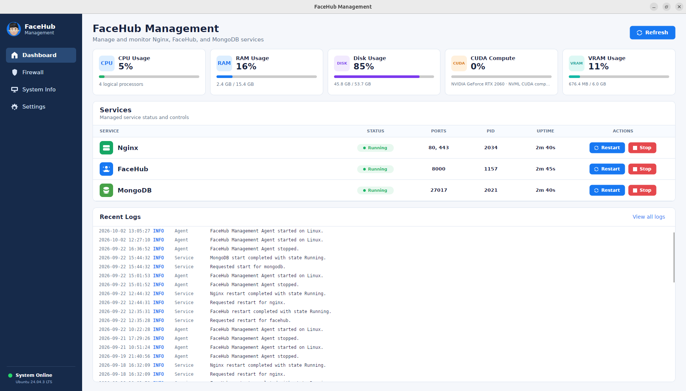
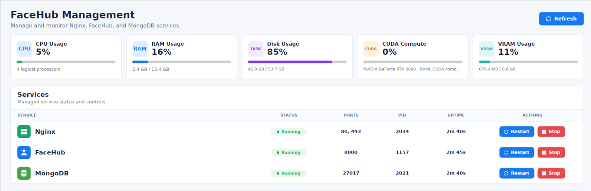
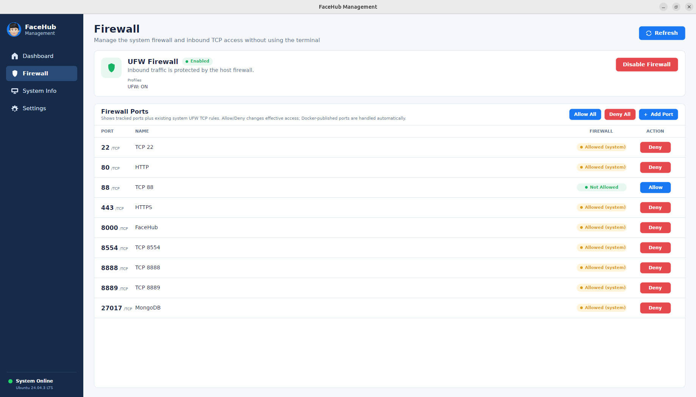
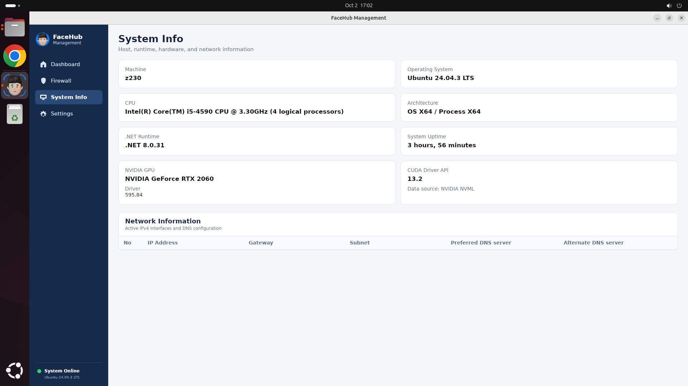
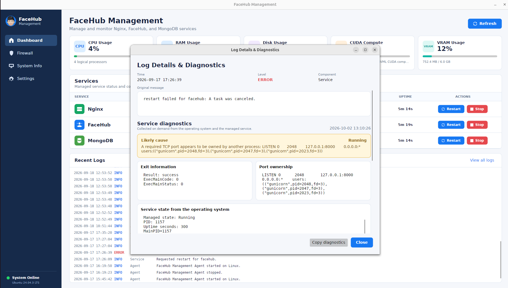

<p align="center">
  
</p>

<h1 align="center">FaceHubMgr</h1>

<p align="center">
  <strong>Ứng dụng quản lý và giám sát hệ thống FaceHub trên Windows và Ubuntu.</strong>
</p>

<p align="center">
  Theo dõi tài nguyên, quản lý service, firewall, log và trạng thái hệ thống
  từ một giao diện desktop duy nhất.
</p>

<p align="center">
  <strong>Tiếng Việt</strong> ·
  <a href="README.en.md">English</a>
</p>

<p align="center">
  
  
  
  
</p>

<p align="center">
  <a href="#tính-năng">Tính năng</a> •
  <a href="#ảnh-minh-họa">Ảnh minh họa</a> •
  <a href="#kiến-trúc">Kiến trúc</a> •
  <a href="#cài-đặt">Cài đặt</a> •
  <a href="#build-từ-source">Build</a> •
  <a href="#cấu-hình">Cấu hình</a>
</p>

---

<p align="center">
  
</p>

## Giới thiệu

**FaceHubMgr** là ứng dụng desktop đa nền tảng được xây dựng để hỗ trợ
giám sát và quản lý các máy tính đang vận hành hệ thống **FaceHub**.

Thay vì phải chuyển qua lại giữa nhiều công cụ và command như:

```text
systemctl
journalctl
ufw
nvidia-smi
free
df
ip
```

FaceHubMgr tập trung các thao tác quản trị thường dùng vào một giao diện
duy nhất.

Ứng dụng phù hợp cho:

- Kỹ thuật viên triển khai FaceHub
- Người vận hành hệ thống
- Máy chủ hoặc workstation chạy FaceHub
- Hệ thống cần giám sát nhanh tình trạng service và tài nguyên
- Môi trường cần hạn chế thao tác trực tiếp bằng command line

> FaceHubMgr không thay thế các công cụ quản trị hệ điều hành.
> Terminal và các công cụ hệ thống vẫn được sử dụng khi cần debug chuyên sâu.

---

## Tính năng

### Giám sát tài nguyên hệ thống

FaceHubMgr cung cấp thông tin tài nguyên theo thời gian thực:

- CPU Usage
- RAM Usage
- Disk Usage
- NVIDIA GPU Usage
- VRAM Usage
- GPU Model
- NVIDIA Driver
- CUDA Driver API
- Thông tin Network

---

### Quản lý Service

Theo dõi và điều khiển các service liên quan đến hệ thống FaceHub.

Ví dụ:

- FaceHub
- Nginx
- MongoDB

FaceHubMgr có thể hiển thị:

- `Running`
- `Starting`
- `Stopping`
- `Stopped`
- `Failed`
- `Unknown`
- PID
- Process uptime
- Port được cấu hình

Các thao tác hỗ trợ:

- Start
- Stop
- Restart

---

### Quản lý Firewall

FaceHubMgr hỗ trợ quản lý các TCP port thường được sử dụng trong hệ thống.

Có thể:

- Xem danh sách port
- Thêm port
- Allow port
- Deny port
- Refresh trạng thái firewall

> **Cảnh báo**
>
> Thay đổi firewall có thể làm mất kết nối từ xa tới máy.
> Hãy đặc biệt cẩn thận với SSH hoặc các port quản trị khác.

---

### Logs

FaceHubMgr cung cấp:

- Recent Logs trên Dashboard
- Trang Logs riêng
- Xem chi tiết log
- Agent rolling logs
- Thông tin diagnostic và hoạt động hệ thống

---

### Hỗ trợ đa nền tảng

| Hệ điều hành | Trạng thái | Backend quản lý Service |
|---|---|---|
| Ubuntu Linux | ✅ Hỗ trợ | systemd |
| Windows 10 | ✅ Hỗ trợ | Windows SCM |
| Windows 11 | ✅ Hỗ trợ | Windows SCM |

---

## Ảnh minh họa

### Dashboard

<p align="center">
  
</p>

### Services

<p align="center">
  
</p>

### Firewall

<p align="center">
  
</p>

### System Information

<p align="center">
  
</p>

### Logs

<p align="center">
  
</p>

---

## Kiến trúc

FaceHubMgr tách giao diện desktop khỏi các thao tác yêu cầu quyền quản trị.

```text
┌───────────────────────────────┐
│       FaceHubMgr Desktop      │
│          Avalonia UI          │
└───────────────┬───────────────┘
                │
                │ Local IPC
                ▼
┌───────────────────────────────┐
│    FaceHub Management Agent   │
│       Privileged Service      │
└───────────────┬───────────────┘
                │
        ┌───────┼────────┐
        ▼       ▼        ▼
     systemd/   UFW/    NVML/
       SCM       OS     NVIDIA
```

Desktop UI không cần chạy toàn bộ bằng quyền `root` hoặc Administrator
trong quá trình sử dụng bình thường.

Các thao tác yêu cầu đặc quyền được thực hiện bởi
**FaceHub Management Agent**.

---

### IPC trên Ubuntu

Desktop giao tiếp với Agent thông qua Unix Domain Socket:

```text
/run/facehub-management/agent.sock
```

Socket được giới hạn quyền cho group:

```text
facehub-management
```

---

### IPC trên Windows

Windows sử dụng local Named Pipe:

```text
FaceHubManagement.Agent
```

Named Pipe sử dụng ACL và không cho phép remote client truy cập trực tiếp.

---

## Công nghệ

FaceHubMgr được xây dựng chủ yếu bằng:

- **C#**
- **.NET 8**
- **Avalonia UI**
- **systemd** trên Linux
- **Windows Service Control Manager** trên Windows
- **NVML** để lấy thông tin NVIDIA GPU
- **Unix Domain Socket** trên Linux
- **Named Pipe** trên Windows
- **UFW / iptables** trên Ubuntu

---

## Cài đặt

## Ubuntu

FaceHubMgr có thể được đóng gói dưới dạng Debian package.

Ví dụ:

```bash
sudo apt install ./facehub-management_<version>_amd64.deb
```

Package cài đặt:

- FaceHubMgr Desktop
- FaceHub Management Agent
- Configuration
- systemd service
- Desktop launcher

Sau khi cài đặt, kiểm tra Agent:

```bash
systemctl status facehub-management-agent.service
```

Kiểm tra IPC socket:

```bash
ls -l /run/facehub-management/agent.sock
```

Nếu user hiện tại vừa được thêm vào group:

```text
facehub-management
```

hãy **logout và login lại một lần** trước khi mở FaceHubMgr.

---

## Windows

Sử dụng installer được tạo bởi project.

Installer triển khai:

- Desktop application
- FaceHub Management Agent
- Configuration
- Windows Service
- Start Menu shortcut
- Desktop shortcut nếu được chọn

Kiểm tra Agent bằng PowerShell:

```powershell
Get-Service FaceHubManagementAgent
```

---

## Build từ source

### Yêu cầu

- .NET SDK 8
- Git
- Ubuntu 24.04 hoặc Windows 10/11
- NVIDIA Driver hỗ trợ NVML nếu cần theo dõi NVIDIA GPU

Kiểm tra .NET SDK:

```bash
dotnet --version
```

Hoặc:

```bash
dotnet --list-sdks
```

Project sử dụng `global.json` để xác định phiên bản SDK phù hợp.

---

## Build trên Ubuntu

Clone repository:

```bash
git clone <YOUR_REPOSITORY_URL>
cd FaceHubManagement
```

Restore dependency:

```bash
dotnet restore FaceHubManagement.sln
```

Build Release:

```bash
dotnet build FaceHubManagement.sln -c Release
```

Cấp quyền execute cho các script:

```bash
chmod +x scripts/publish-linux.sh
chmod +x packaging/linux/build-deb.sh
```

Build Debian package:

```bash
./packaging/linux/build-deb.sh linux-x64
```

Package sau khi build nằm tại:

```text
artifacts/packages/
```

### ARM64

Có thể build package cho ARM64 bằng:

```bash
./packaging/linux/build-deb.sh linux-arm64
```

---

## Build trên Windows

Restore và build:

```powershell
dotnet restore .\FaceHubManagement.sln
dotnet build .\FaceHubManagement.sln -c Release
```

Publish:

```powershell
.\scripts\publish-windows.ps1
```

Để tạo installer, cài **Inno Setup 6** rồi chạy:

```powershell
.\scripts\build-installer.ps1
```

Installer được tạo trong:

```text
artifacts\installer\
```

---

## Cấu hình

FaceHubMgr quản lý các service đã tồn tại trên hệ điều hành.

FaceHubMgr **không chạy Nginx, FaceHub hoặc MongoDB dưới dạng process con
của Desktop application**.

Điều này giúp lifecycle của các service độc lập với giao diện FaceHubMgr.

---

### Ubuntu

File cấu hình Agent:

```text
/etc/facehub-management/agentsettings.json
```

Sau khi thay đổi cấu hình:

```bash
sudo systemctl restart facehub-management-agent.service
```

---

### Windows

File cấu hình Agent:

```text
C:\ProgramData\FaceHub Management\agentsettings.json
```

Sau khi thay đổi:

```powershell
Restart-Service FaceHubManagementAgent
```

Tên service và port nên được điều chỉnh theo hệ thống FaceHub thực tế.

---

## NVIDIA GPU Monitoring

FaceHubMgr sử dụng **NVIDIA Management Library — NVML** để lấy thông tin GPU.

Trước tiên nên kiểm tra:

```bash
nvidia-smi
```

Nếu `nvidia-smi` hoạt động bình thường, FaceHubMgr có thể lấy các thông tin
GPU tương ứng thông qua NVML.

Các thông tin có thể bao gồm:

- GPU Name
- GPU Usage
- VRAM Usage
- VRAM Total
- Driver Version
- CUDA Driver API Version

Nếu NVML không khả dụng, GPU monitoring có thể không hoạt động nhưng:

- CPU monitoring
- RAM monitoring
- Service management
- Các chức năng hệ thống khác

vẫn có thể tiếp tục hoạt động.

> Không bắt buộc phải cài CUDA Toolkit chỉ để đọc GPU Usage và VRAM.
> Thành phần cần thiết chủ yếu là NVIDIA Driver và NVML.

---

## Kiểm tra hệ thống

FaceHubMgr bao gồm một công cụ integration smoke test.

### Ubuntu

```bash
/opt/facehub-management/smoketest/FaceHubManagement.SmokeTest
```

### Windows

```powershell
.\FaceHubManagement.SmokeTest.exe
```

Smoke test mặc định không thay đổi trạng thái service.

Để kiểm tra thao tác thật:

```text
FaceHubManagement.SmokeTest --actions --service nginx
```

hoặc:

```text
FaceHubManagement.SmokeTest --actions --service facehub
```

> `--actions` có thể Start hoặc Restart service thật.
> Chỉ sử dụng trên máy hoặc service an toàn để bảo trì.

---

## Cấu trúc Repository

```text
FaceHubManagement/
├── src/
│   ├── FaceHubManagement.Core/
│   ├── FaceHubManagement.Agent/
│   ├── FaceHubManagement.Desktop/
│   └── FaceHubManagement.SmokeTest/
│
├── config/
│   └── agentsettings.json
│
├── packaging/
│   ├── linux/
│   └── windows/
│
├── scripts/
├── docs/
├── .github/
│   └── workflows/
│
├── FaceHubManagement.sln
└── README.md
```

### Các project chính

| Project | Chức năng |
|---|---|
| `FaceHubManagement.Core` | Model dùng chung, protocol và IPC |
| `FaceHubManagement.Agent` | Local Agent thực hiện các thao tác đặc quyền |
| `FaceHubManagement.Desktop` | Desktop UI xây dựng bằng Avalonia |
| `FaceHubManagement.SmokeTest` | Kiểm tra integration và deployment |

---

## Mô hình bảo mật

FaceHubMgr được thiết kế để tách Desktop UI khỏi các thao tác đặc quyền.

Một số nguyên tắc chính:

- Không cần chạy Desktop bằng `root`
- Privileged operation được cô lập trong Agent
- IPC chỉ hoạt động local
- Unix socket có permission giới hạn
- Windows Named Pipe sử dụng ACL
- Service action được giới hạn
- IPC frame có kích thước tối đa
- Request có ID và timeout
- Không expose shell command tùy ý từ Desktop

---

## Lưu ý

FaceHubMgr là **phần mềm quản lý**, không phải installer hoặc trình sửa lỗi
cho các thành phần được quản lý.

FaceHubMgr không tự động cài đặt hoặc sửa chữa:

- FaceHub
- Nginx
- MongoDB
- NVIDIA Driver
- Các service hệ thống khác

Nếu một service bị lỗi, có thể cần kiểm tra trực tiếp bằng công cụ của hệ
điều hành.

Ví dụ:

```bash
systemctl status facehub.service
```

và:

```bash
journalctl -u facehub.service
```

Khi thao tác Firewall trên máy từ xa, hãy đảm bảo port SSH hoặc port quản
trị cần thiết vẫn được Allow trước khi áp dụng thay đổi.

---

## Đóng góp

Issue và Pull Request được hoan nghênh cho:

- Bug fix
- Cải thiện UI/UX
- Platform compatibility
- Performance
- Monitoring
- Packaging
- Documentation

Khi báo lỗi, nên cung cấp:

- Phiên bản hệ điều hành
- Phiên bản FaceHubMgr
- Trạng thái service liên quan
- Agent logs
- Các bước tái hiện lỗi
- GPU và NVIDIA Driver nếu lỗi liên quan GPU